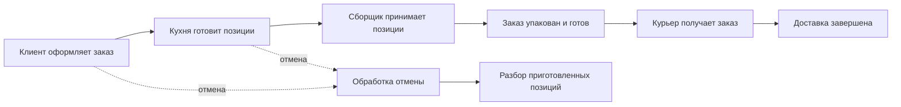
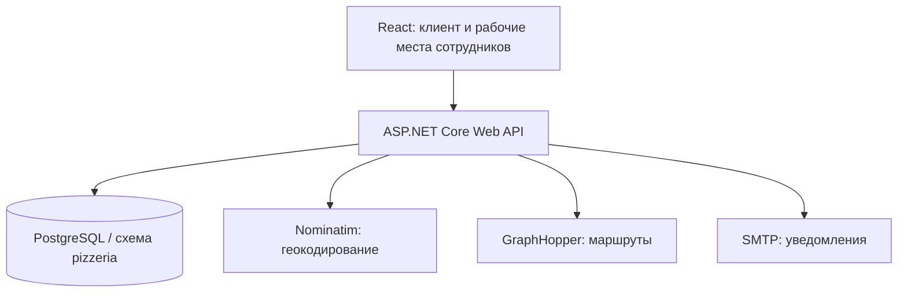

# Pizzeria Management

Учебная система управления пиццерией: от выбора пиццы и оформления заказа до работы кухни, сборки и доставки. Проект объединяет клиентский интерфейс, рабочие места сотрудников и API с PostgreSQL.

**Задача:** связать участников обработки заказа одним процессом, сделать состояние заказа видимым клиенту и дать сотрудникам отдельные инструменты для их этапов работы.

> **Статус:** опубликована исходная реализация интерфейса и API. Полная исходная схема PostgreSQL пока не восстановлена: имеющихся миграций недостаточно для подтверждённого запуска на пустой базе. Публичного демо нет; запуск этой публикации и сквозной сценарий не проверены. Подробности — в [инструкции по подготовке окружения](docs/setup.md).

## Возможности и роли

- **Клиент:** регистрация и вход, меню пицц, корзина, оформление заказа с адресом и точкой на карте, просмотр заказов и статуса, отзывы.
- **Администратор:** управление пиццами, просмотр заказов, модерация отзывов, очередь доставки, переназначение курьера и оперативные показатели.
- **Повар:** очередь позиций заказов и отметка о готовности каждой позиции.
- **Сборщик:** приём готовых позиций, проверка комплектности, упаковка заказа и обработка приготовленных позиций отменённых заказов.
- **Курьер:** начало и завершение смены, перерыв, получение заказов, выезд и возврат, завершение доставки и карта маршрута.

В API также предусмотрены обновление JWT-сессии, очередь почтовых уведомлений, геокодирование через Nominatim и построение маршрутов через GraphHopper. Для внешних интеграций требуется отдельная настройка.

## Процесс заказа

Ниже показан основной пользовательский сценарий. Это схема бизнес-процесса, а не исчерпывающая спецификация допустимых переходов API.



У заказа, его позиций и доставки разные статусы. Это позволяет отдельно отслеживать приготовление конкретной пиццы, комплектность всего заказа и работу курьера. Например, сборщик не может упаковать заказ, пока остались позиции на кухне или ещё не принятые им готовые позиции.

Сценарии, сущности и ограничения подробнее описаны в [заметках о бизнес-процессе](docs/business-process.md).

## Архитектура и стек



- **Интерфейс:** React 19, Vite 7, React Router, Tailwind CSS, Radix UI, Leaflet / React Leaflet.
- **Сервер:** C#, .NET 8, ASP.NET Core, Entity Framework Core 8, ASP.NET Core Identity, JWT, Swagger.
- **Данные:** PostgreSQL, Npgsql, таблицы предметной области, перечисления статусов, SQL-функция расчёта суммы и финансовое представление.
- **Интеграции:** Nominatim, GraphHopper, MailKit / SMTP.

## Что посмотреть в коде

- [Маршруты и рабочие места интерфейса](frontend/src/App.jsx).
- [Модель данных и связи сущностей](backend/Pizzeria/Data/PizzeriaContext.cs).
- [Статусы заказа, доставки и позиций](backend/Pizzeria/Data/ModelsEnums.cs).
- [Проверка комплектности и упаковка](backend/Pizzeria/Controllers/CollectorController.cs).
- [Смены, очередь и доставка курьером](backend/Pizzeria/Controllers/courierController.cs).
- [Оперативные показатели администратора](backend/Pizzeria/Controllers/AdminDashboardController.cs).

## Структура

```text
frontend/                  React-приложение и пример .env
backend/Pizzeria.sln       Решение .NET
backend/Pizzeria/          API, модели, сервисы и имеющиеся миграции
docs/business-process.md   Роли, правила и определения показателей
docs/setup.md              Подготовка окружения и ограничения запуска
```

## Подготовка и запуск

Нужны Node.js, совместимый с Vite 7, .NET SDK 8 и PostgreSQL. Сначала необходимо восстановить полную схему базы и SQL-объекты, затем заполнить локальную конфигурацию. **Команды запуска без этого шага не дают рабочую систему.**

Пошаговые действия, перечень настроек и команды находятся в [docs/setup.md](docs/setup.md). В репозитории нет паролей, ключей интеграций, пользовательских выгрузок базы, зависимостей и готовых сборок.

## Ограничения и следующие шаги

- Восстановить исходную схему БД и сделать воспроизводимую установку с синтетическими демоданными.
- Проверить весь сценарий заказа на подготовленном окружении и добавить проверки переходов состояний и прав доступа. Наличие ролей в интерфейсе само по себе не подтверждает полноту серверных проверок.
- Уточнить показатели: `deliveredToday` сейчас означает «созданные сегодня заказы с текущим статусом Delivered», а `activeOrders` не включает Ready. Это не показатели «все доставки за сегодня» и «все незавершённые заказы».
- Разделы закусок, напитков и скидок в интерфейсе пока являются заглушками. Онлайн-эквайринг не реализован.
- Подготовить скриншоты после восстановления окружения. Изображения рабочего продукта и результаты тестов не подменяются макетами.

## Личный вклад

Проект выполнен в команде; основная техническая реализация — автор портфолио: клиентский интерфейс, серверная логика обработки заказов и рабочих мест сотрудников, взаимодействие с базой данных и внешними сервисами.

Сторонние библиотеки используются как зависимости и перечислены в манифестах. Иконки в `frontend/src/assets` с префиксом `icons8-` получены из [Icons8](https://icons8.com/).
